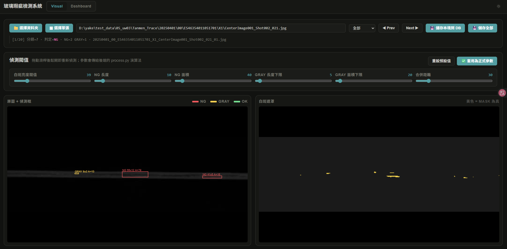
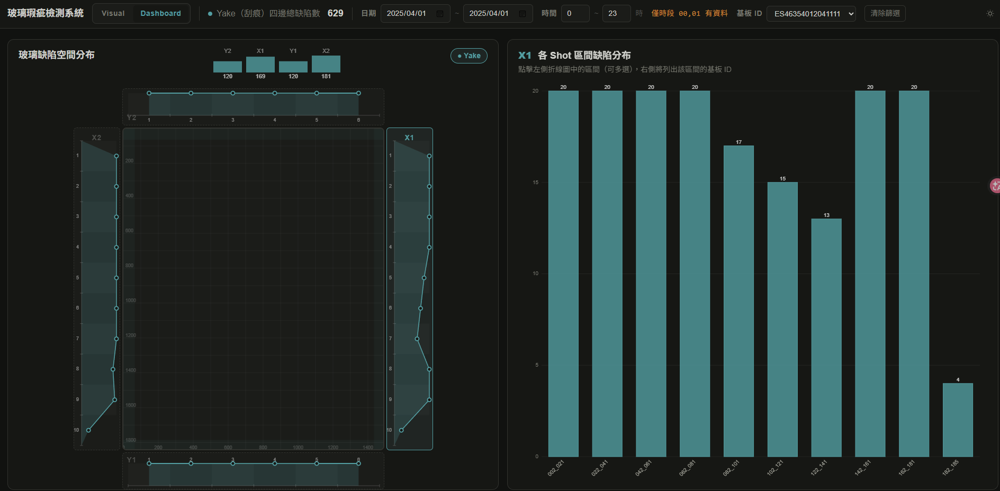

# Yake — 玻璃白斑瑕疵檢測系統

玻璃基板白斑（Yake）瑕疵的自動檢測與可視化系統。從產線原圖出發，沿長邊切成 20 塊、逐塊判定 NG / GRAY / OK，結果寫入 PostgreSQL，並提供兩個網頁分頁做二次確認與統計分析。

## 畫面

### Visual — 品管站

載入切割區塊、即時拖拉閥值重新偵測、確認後手動存回 DB。左側是原圖疊偵測框（紅 NG、黃 GRAY、綠 OK），右側是白斑遮罩（黃色 = 超過亮度閥值）。



### Dashboard — 戰情室

從 DB 撈記錄，畫出玻璃 4 邊（Y1 / Y2 / X1 / X2）的缺陷空間分布，以及各 Shot 區間的缺陷數量；可依日期、時段、基板 ID 篩選。



> 註：空間分布圖目前是在邊緣帶上隨機撒點，**尚未是真實物理座標**（見「待辦」）。

## 架構

```
產線原圖 ──> process.py ──> 沿長邊切 20 塊 ──> detect_defect_full() ──> NG/GRAY/OK
                                                      │
                                          分流存檔 + 批次寫入
                                                      ↓
                                        PostgreSQL: detection_records
                                                      ↑
                              ┌───────────────────────┴───────────────────────┐
                        Visual 分頁                                   Dashboard 分頁
                    （二次確認、覆寫存回）                          （統計、篩選、明細）
```

`detection_records` 是唯一的資料真相，兩個 UI 都消費同一張表。

### 檔案角色

| 檔案 | 角色 |
|---|---|
| `process.py` | Pipeline 主體 + 偵測核心 `detect_defect_full()` + canonical parser `parse_segment_filename()` |
| `watch.py` | 生產端常駐監看：某小時資料收完就自動整批切割＋檢測＋寫 DB |
| `server.py` | FastAPI 後端：`/api/*` + StaticFiles 掛載 `ui/` |
| `split.py` | 檔案掃描、日期範圍、config / log / cache 讀寫 |
| `db.py` | PostgreSQL 連線池（lazy，可重開）+ CRUD |
| `schema.sql` | `detection_records` 完整 DDL（19 欄 + 10 索引） |
| `seed_records.py` | 灌固定種子假資料 |
| `split_config.json` | Pipeline 全部參數 |
| `ui/` | index.html + app.js（殼）+ visual.js + dashboard.js + styles.css |
| `docs/handover.html` | **完整圖文交接文件**：架構圖、函式詳解、API 對照、排錯表 |

## 環境需求

Windows 11 ・ Python 3.10 ・ PostgreSQL 17 ・ 前端 vanilla JS + Canvas（無打包器）

```powershell
pip install fastapi uvicorn "psycopg[binary,pool]" python-dotenv
pip install pillow numpy scipy opencv-python
```

### 設定

複製 `.env.example` 為 `.env` 並填入實際連線資訊（`.env` 不進版控）：

```
PG_HOST=localhost
PG_PORT=5432
PG_DB=yake
PG_USER=yake_app
PG_PASSWORD=your_password_here
PG_POOL_MIN=1
PG_POOL_MAX=10
```

資料表用 `schema.sql` 建立。注意 `yake_app` 並非 table owner，**不能做 DDL**，建表需由 DBA 執行。

## 使用

```powershell
# 啟動 Web UI（http://127.0.0.1:8000）
python -m uvicorn server:app --reload --port 8000 --host 127.0.0.1

# Pipeline 試跑前 50 張
python process.py --limit 50

# Pipeline 跑全部、並重新掃描檔案清單
python process.py --limit all --refresh-cache

# 產線常駐監看
python watch.py                  # 每 poll 秒掃一次，Ctrl+C 結束
python watch.py --once           # 只掃一次（排程用）

# 灌假資料 / DB 健檢
python seed_records.py --n 700 --wipe
python -c "import db; db.open_pool(); print(db.count_records())"
```

> uvicorn **不可用 `--workers 2` 以上**：`/api/pick` 的 tkinter 對話框會壞（並發已用鎖序列化）。

## 偵測參數

`split_config.json` 中與偵測相關的欄位，對應 Visual 分頁的六根滑桿：

| 參數 | 預設 | 意義 |
|---|---|---|
| `white_threshold` | 39 | 白斑亮度閥值（三通道平均 > 此值即為白斑） |
| `len_ng` | 10 | NG 長度門檻 |
| `area_ng` | 40 | NG 面積門檻 |
| `len_gray_min` | 5 | GRAY 長度下限 |
| `area_gray_min` | 20 | GRAY 面積下限 |
| `merge_dist` | 30 | 相鄰白斑合併距離 |

在 Visual 分頁按「套用為正式參數」會寫回 `split_config.json`，pipeline 與 `watch.py` 下次執行即採用。

## API

| 端點 | 用途 |
|---|---|
| `GET /api/default-params` `/api/default-folder` | 讀預設參數與資料夾 |
| `POST /api/apply-params` | 把 Visual 調好的閥值寫回 `split_config.json` |
| `GET /api/pick` | 開啟 tkinter 選檔對話框 |
| `GET /api/segments` | 列出切割區塊 |
| `POST /api/detect` | 即時偵測（**絕不寫 DB**） |
| `GET /api/records` `POST /api/records` | 查詢記錄（Dashboard） |
| `POST /api/save-detection` `/api/save-all` | 存回 DB（覆寫語意） |
| `GET /api/hours-available` | 查某日有資料的時段 |

## 核心規則（勿改壞）

1. **`/api/detect` 絕不寫 DB** — 拖滑桿會炸出垃圾記錄。寫入只有兩個入口：pipeline 的 `bulk_insert_records()` 與 Visual 的 `POST /api/save-detection`，兩者皆為覆寫語意（`ON CONFLICT (segment_path) DO UPDATE`，id 不變）。
2. **Segment 檔名**：`{date:8}_{hour:2}_{board_id}_{side}_{base_name}_{seg:02d}.jpg`。`base_name` 內含底線，**只能用 `process.parse_segment_filename()` 解析**，不可自己 split。
3. **Shot 區間**：短邊（Y1/Y2）6 區間、長邊（X1/X2）10 區間，長邊末段是 **`Shot182_185`**（不是 196）。此常量在 `ui/dashboard.js` 與 `seed_records.py` 各一份，**改規格必須同步**。
4. `shot_number = 區間起點 + segment_index - 1`（clip 到區間終點）。`side` 取產線路徑倒數第二層，抓不到就**跳過 DB 寫入**（不猜）。
5. DB 幾乎全欄 NOT NULL：meta 缺漏時圖檔照常輸出、record 跳過（log 會統計「meta 缺漏未寫 DB」）。

## 測試資料

`test_data/` 下保留兩張代表性樣本圖（X1 長邊、Y1 短邊各一），供 pipeline 與偵測核心試跑。完整的 660 張產線影像未進版控。

補樣本圖時 `.gitignore` 會擋掉整個 `test_data/`，需用 `git add -f <路徑>` 強制加入。

## 待辦

1. **真實座標映射**：`bboxes` + `shot_number` → 玻璃物理座標（Dashboard 目前是邊緣帶隨機撒點）。
2. **smoke test 收進 repo**（`tests/smoke.py`：parser、detect、pool 重開、覆寫、live endpoint）。
3. `defect_type` 擴充（目前恆為 `yake`，schema 已預留）。

---

更詳細的架構圖、每支程式的函式與參數詳解、命名規則圖解、排錯對照表，見 **[docs/handover.html](docs/handover.html)**。

`legacy/` 為已淘汰的舊架構（未進版控），不再維護。
